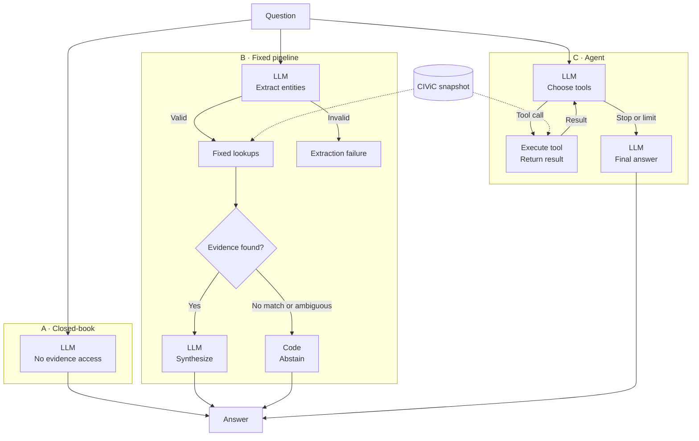
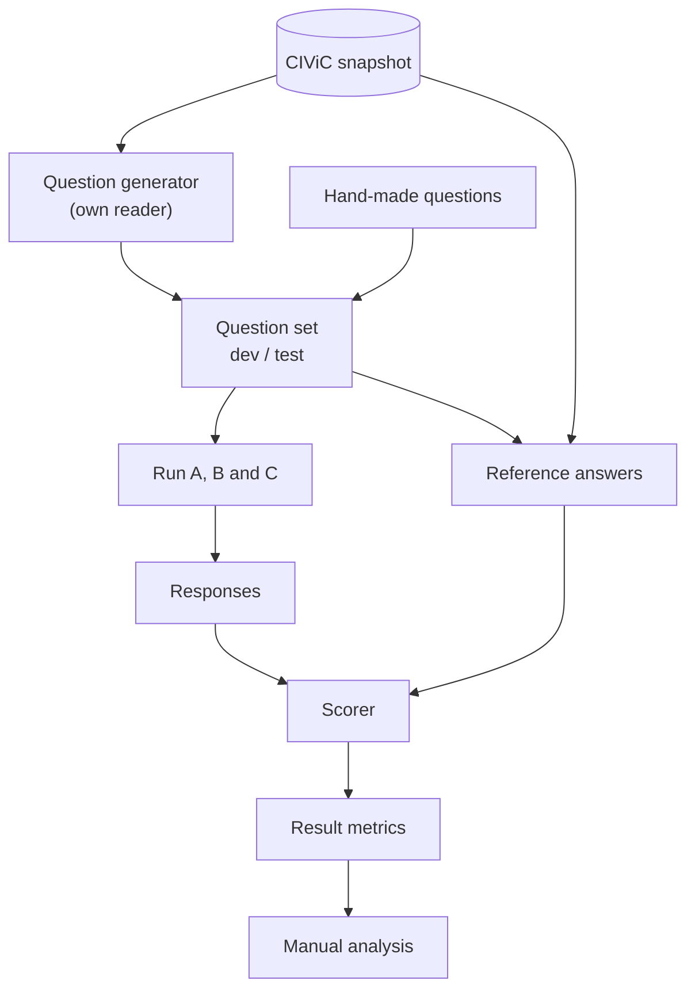

# CIViC Agent

This project builds a CLI assistant that answers cancer-variant questions using CIViC, a curated database of clinical evidence. It also evaluates three approaches: closed-book answering (A), a fixed evidence-retrieval pipeline (B), and an agent that selects its own tools (C).

*Research software. Nothing here is clinical advice.*

The evaluation investigates two questions:

1. **Does access to curated CIViC evidence improve accuracy over closed-book answering?**
2. **Does allowing the model to choose its own lookups improve performance over a fixed retrieval pipeline?**

The experiment evaluated all three approaches on 50 questions: 40 templated and 10 hand-made.

**Retrieval substantially improved accuracy.** On templated questions, the fixed pipeline outperformed closed-book answering by a large margin (35/40 vs 7/40 correct answers, p < 0.001). On hand-made questions, the fixed pipeline and agent answered 8/10 and 10/10, compared with 2/10 for the closed-book model.

**Agent-controlled retrieval improved observed accuracy, but its advantage was not statistically established.** The agent answered 39/40 templated questions and 10/10 hand-made questions correctly, outperforming the fixed pipeline on both subsets. However, the templated difference was not statistically significant (p = 0.125). The agent handled alternative disease terminology more successfully, but required about 7 times the fixed pipeline's time per question and 13 times its prompt tokens.

Two of the agent's four additional correct template answers came from cases where the fixed pipeline rejected evidence statements that did not explicitly support the exact variant, despite qualifying under the reference-answer rules. These improvements therefore reflect agreement with the benchmark rather than an unambiguous improvement in scientific reasoning.

## System Architecture

The assistant uses a local Qwen3.8-27B model served through an OpenAI-compatible API and a fixed snapshot of CIViC (01-Nov-2026). All three conditions use the same model and structured answer format, but differ in how they access evidence.

### Overview


**Figure 1**. Architecture of the three evaluated conditions. All use the same language model, while B and C access CIViC snapshot through different retrieval strategies.

### A: Closed-book

The model receives the question without access to CIViC records or retrieval tools. It must answer from its learned knowledge or abstain when it cannot provide sufficient evidence.

This serves as the baseline for measuring the value of retrieval.

### B: Fixed Pipeline

The assistant follows a predefined sequence:

1. **Extraction:** The model extracts the gene, the variant and the disease from the question.
2. **Retrieval:** The code resolves the gene and variant against the CIViC snapshot, and retrieves evidence for the specified disease.
3. **Synthesis:** If evidence is found, the model receives the retrieved records and produces a structured answer.

The code handles missing or ambiguous entities and missing evidence through deterministic abstentions. If extraction fails, the question receives no answer and is scored as incorrect.

The model interprets the evidence but does not decide which lookups to perform.

### C: Agent

The model can choose among four tools:

- `search_gene`: Find a gene or molecular feature by name or alias.
- `search_variant`: Find variants belonging to a feature.
- `list_diseases`: List diseases with evidence for a molecular profile.
- `get_evidence`: Retrieve evidence records for a molecular profile, optionally filtered by disease.

Unlike B, C decides which tools to call, in what order, and with which arguments. It can inspect intermediate results and perform additional lookups before answering.

A tool loop executes the calls, returns their results to the model, and enforces two limits: at most six tool calls (needed path is four) and a stop after two repeated calls with the same arguments. Once the model stops requesting tools or reaches a limit, it makes a final structured-answer request without tools.

### Shared components and design tradeoff

B and C use the same lookup functions and CIViC snapshots. Both provide evidence statements alongside structured fields, allowing the model to interpret underlying records.

The central difference is **who controls retrieval**. B uses a predictable extraction-retrieval-synthesis pipeline, while C gives the model flexibility to investigate the question across multiple turns.

That flexibility may help resolve ambiguous terminology or recover from unsuccessful lookups, but it also introduces additional model calls, latency, and opportunities for unnecessary retrieval.

### Answer Format

All three conditions return the same JSON object (schema in `agent/answer.py`). See an example below (C's answer to test-34):

```json
{
  "gene": "BRCA2",
  "variant": "M1R",
  "disease": "Ovarian Cancer",
  "explanation": "One CIViC evidence item (EID2879) supports sensitivity to rucaparib monotherapy in Ovarian Cancer with BRCA2 M1R, based on a phase 2 study showing improved PFS and duration of response in BRCA1/2-mutated patients.",
  "abstain": false,
  "abstain_reason": null,
  "drugs": ["Rucaparib"],
  "evidence_ids": ["EID2879"]
}
```

When the condition declines, `abstain` is true, `drugs` is empty and `abstain_reason` is one of `no_evidence`, `unknown_gene` or `ambiguous`. Output that does not match the schema counts as unparseable.

### CLI

`python -m agent.cli` answers one free-text question with any condition, using the same code path, settings and snapshot as the evaluation. It prints the answer and a table with one row per cited evidence item. The table is built from the CIViC snapshot by code. Each question is logged.

## Dataset and Questions

### CIViC Snapshot

The experiment uses a fixed CIViC snapshot from **November 1, 2026** rather than querying the live database. CIViC provides curated evidence linking molecular variants, diseases and therapies.

Only accepted, non-flagged evidence items were included, across all evidence levels (A-E). The experiment focuses on single-variant molecular profiles, excluding profiles that combine multiple variants.

The snapshot is stored as TSV files, with a manifest recording source URLs and SHA-256 checksums. This ensures all conditions use the same underlying evidence and that the dataset can be reproduced.

### Question Types

The evaluation focuses on two question templates:

1. **Sensitivity:** Which therapies have CIViC evidence items supporting sensitivity in a given disease with a given molecular profile?
2. **Resistance:** Which therapies have CIViC evidence items supporting resistance in a given disease with a given molecular profile?

For example:

> Which therapies have CIViC evidence items supporting sensitivity in Melanoma with BRAF V600K?

The question set also includes cases where no matching evidence exists, requiring the assistant to abstain.

### Question Set and Split

The evaluation contains **75 questions**, divided into development and test sets.

| Question type | Development | Test | Total |
| --- | ---: | ---: | ---: |
| Templated | 20 | 40 | 60 |
| Hand-made | 5 | 10 | 15 |
| **Total** | **25** | **50** | **75** |

Templated questions were generated from the snapshot using a fixed random seed (7). They include sensitivity (25), resistance (25), and no-evidence cases (10), as well as alternative protein-variant notation.

Hand-made questions were added to test cases less directly represented by the templates, including disease wording, gene alias, ambiguous gene alias, unknown gene and free wording.

The split is **gene-exclusive**: no gene appearing in the development set also appears in the test set. This reduces overlap between questions used to refine the system and those used for final evaluation.

To limit question complexity and reduce overrepresentation of individual genes, the generator excludes candidates with more than five supported therapies and samples at most two questions per gene. Candidates with ambiguous gene or variant names are also excluded from the templated questions, leaving ambiguity testing to the hand-made set.

## Reference Answers

Reference answers were generated programmatically from the CIViC snapshot, using a separate TSV reader rather that the lookup functions used by conditions B and C. The scorer reuses the generator's snapshot reader and therapy-parsing rules. This separation reduces the risk that a bug in the assistant's retrieval implementation also affects the expected answers.

Selected reference answers and their underlying evidence statements were manually inspected because structured fields alone may not capture qualifications expressed in the evidence text. However, systematic errors in the reference generation rules remain possible.

### Constructing Reference Answers

For each templated question, the generator identifies evidence items matching the molecular profile, disease and requested response (sensitivity or resistance).

An evidence item qualifies when it meets all of these criteria:

- Evidence type is **Predictive**
- Evidence direction is **Support**
- Clinical significance matches the requested sensitivity or resistance
- Molecular profile and disease match the question
- The evidence item is accepted and not flagged
- The therapy interaction is either a single drug or **Substitutes**, where each listed therapy counts independently

A therapy is included if at least one qualifying evidence item supports it, regardless of evidence level. Conflicting evidence does not cancel a qualifying item because the questions ask which therapies have supporting evidence, not which therapies are recommended.

The reference answer contains the expected set of therapy names and the supporting CIViC evidence IDs. Therapy names follow CIViC's terminology, without synonym matching.

### Abstention Cases

Some questions are intentionally constructed without applicable evidence.

For templated no-evidence questions, the selected variant has no accepted evidence items in the specified disease, including evidence associated with combined molecular profiles. The disease nevertheless had evidence involving another variant of the same gene.

Those questions test whether the assistant distinguishes between evidence for a specific molecular profile and evidence for related variants.

The correct response is an abstention with an empty therapy list and the reason `no_evidence`.

Hand-made questions also include cases involving unknown or ambiguous entities, with the expected abstention determined by the question.

### Scope of Correctness

The reference answers represent **the therapies supported by qualifying CIViC evidence under the experiment's rules**, not clinical treatment recommendations.

An evidence item may describe preclinical findings, limited evidence or results that do not generalize to all patients. The evaluation measures whether the assistant can retrieve and interpret the specified evidence, rather that whether a therapy should be prescribed.

## Evaluation Methodology

The test run followed a protocol committed before it ran ([docs/protocol.md](protocol.md), commit 2fb598c). The protocol has the full metric definitions, procedure and failure categories. This section covers what is needed to read the results.

### Overview


**Figure 2**. Evaluation pipeline, from question generation and reference answers through execution, automated scoring and manual failure analysis.

### Frozen Setup

Model revision, server version and flags, prompts (hash 284dcde65f23), tool definitions, C's loop limits and the CIViC snapshot were fixed before the test run. Decoding was greedy (temperature 0, seed 7, max 1024 tokens). A check on one dev question gave identical outputs within a session and after a server restart.

Each condition ran once over the 50 test questions. The scorer refuses to compare runs that differ in model, settings, prompt hash or snapshot, or that are missing questions.

### Answer Correctness

The primary metric is exact-set accuracy:

- **Answerable question:** correct if the response does not abstain and its therapies match the reference set exactly. One missing or extra therapy makes it wrong
- **Abstention question:** correct if the response abstains with the expected reason and names no therapies
- **Unparseable response or server error:** wrong, with no retries

Citations don't affect correctness. They are scored separately.

### Secondary Metrics

The results also report drug precision and recall (micro-averaged), citation validity, citation recall, invented citations and retrieved recall (the share of reference evidence IDs that B or C actually saw). Retrieval metrics come from the logged tool calls, so they show what was retrieved, not how it was read. Time, model calls, tool calls, prompt tokens and completion tokens are recorded for every question.

### Statistical Comparison

Conditions answer the same questions, so comparisons use exact two-sided McNemar tests, which count only the questions where two conditions disagree. The two primary tests are on templated questions at 0.05:

1. **B vs A:** The effect of providing CIViC evidence
2. **C vs B:** The effect of letting the model control retrieval

Hand-made comparisons are exploratory: p-values are reported, but no conclusions are drawn from them.

## Development

The 25 development questions were used across three development runs to identify failures and refine the system before evaluating the final test set.

The second development run established the prompts used in the held-out test. Its results were:

| Condition | Correct | Accuracy |
|---|---:|---:|
| A: Closed-book | 6/25 | 24% |
| B: Fixed pipeline | 23/25 | 92% |
| C: Agent | 25/25 | 100% |

Development led to three prompt refinements:

- **Substitutes interactions:** Clarified that each therapy in a Substitutes interaction independently qualifies as a supported therapy
- **Fusion variants:** Specified the `GENE1::GENE2` naming convention to improve extraction of fusion molecular profiles
- **Agent stopping behaviour:** Added an explicit definition of when C should stop requesting tools and produce its final answer

The stopping instruction had little effect. C contiunued making unnecessary tool calls after retrieving sufficient evidence, indicating that prompt instructions were insuficient to control its retrieval cost.

A separate experiment tested sampling instead of greedy decoding. Sampling lost seven previously correct answers without correcting any incorrect ones. Greedy decoding was therefore selected. Thinking mode was left off to save generation time on every call.

The test questions were not used to modify prompts, retrieval behaviour or evaluation rules. The evaluation protocol and configuration were finalised before the test run.

## Results

The three conditions were evaluated on 50 held-out questions: 40 templated and 10 hand-made. All runs completed without API errors or unparseable responses.

### Accuracy

| Condition | Templated (40) | Hand-made (10) | Overall (50) |
|---|---:|---:|---:|
| A: Closed-book | 7 (17.5%) | 2 (20%) | 9 (18%) |
| B: Fixed pipeline | 35 (87.5%) | 8 (80%) | 43 (86%) |
| C: Agent | 39 (97.5%) | 10 (100%) | 49 (98%) |

Both retrieval-based approaches substantially outperformed closed-book answering.

On templated questions, B improved accuracy by 70 percentage points over A. C achieved the highest accuracy, improving by another 10 percentage points over B.

The same ranking appeared on hand-made questions, although the smaller sample limits the conclusions that can be drawn.

### Prediction vs Results

Before the test run, predictions were written in the protocol: the expected outcome was that retrieval would substantially outperform closed-book answering, while the agent might offer a smaller improvement over the fixed pipeline.

After the run, hand-made results matched exactly (A 2, B 8, C 10). Templated results were lower for all three (A 7 vs 10, B 35 vs 38 and C 39 vs 40).

### Statistical Comparison

Exact two-sided McNemar tests were used to compare paired correctness.

| Comparison | Templated p-value | Hand-made p-value |
|---|---:|---:|
| B vs A | 7.45 × 10⁻⁹ | 0.070 |
| C vs B | 0.125 | 0.500 |

On templated questions, B corrected 28 questions that A missed, without losing any questions A answered correctly (28 vs 0). C similarly corrected four B errors without introducing new errors (4 vs 0).

On hand-made questions, B gained seven and lost one. A answered the GIST question correctly from its own knowledge, where B abstained because it could not map GIST to a CIViC disease name.

The improvement from A to B was statistically significant on templated questions. The hand-made comparison showed a similar direction but did not reach the conventional 0.05 significance threshold.

The differences between C and B were not statistically significant in either subset. These results do not establish equivalence, particularly given the small number of disagreements.

### Retrieval and Answer Quality

On templated questions, B achieved 90.7% drug recall and 98% drug precision, compared with 98.1% recall and 100% precision for C.

Both retrieval-based approaches achieved 100% citation validity and reported no invented citations. C also achieved 100% citation recall, compared with 88.1% for B.

B retrieved all reference evidence IDs on templated questions, despite giving five incorrect answers. This points toward problems in answer generation or evidence interpretations rather than missing retrieved records.

On hand-made questions, B retrieved 52.2% of reference evidence IDs, compared with 100% for C. Its two incorrect answers involved alternative disease wording, where it abstained despite relevant evidence being available.

### Efficiency

| Metric, templated questions | A | B | C |
|---|---:|---:|---:|
| Mean time | 10.7 s | 18.9 s | 138.7 s |
| Mean model calls | 1.0 | 1.85 | 6.95 |
| Mean tool calls | 0 | 3.0 | 5.78 |
| Mean prompt tokens | 358 | 886 | 11,600 |
| Mean completion tokens | 101 | 152 | 450 |

C required approximately 7.3 times as much time as B on templated questions and processes approximately 13 times as many prompt tokens.

C stopped requesting tools on its own in 8 of the 50 test questions. The other 42 ended at a loop limit: 30 at the six-call budget, 12 at the duplicate-call guard. 78 of its 289 tool calls came after the evidence was already retrieved.

## Failure Analysis

The 50 test questions produced 41 incorrect answers from A, 7 from B, and 1 from C. Each was tagged by hand with one category, the earliest stage that failed: format, extraction, retrieval, abstention, interpretation or other. Unparseable answers are tagged format automatically: none occured. Only three categories appear below.

All three conditions answered the six no-evidence questions correctly.

### Failure Categories

| Failure type | A | B | C |
|---|---:|---:|---:|
| Abstention error | 37 | 3 | 0 |
| Extraction error | 0 | 2 | 0 |
| Interpretation error | 4 | 2 | 1 |
| **Total** | **41** | **7** | **1** |

### A: Closed-book

A's dominant failure was incorrect abstention, accounting for 37 of its 41 errors.

A's seven correct templated answers are six no-evidence abstentions and one real answer: it answered 1 of the 34 answerable templated questions. It mostly declined rather than guessed. This behaviour avoided some unsupported answers but substantially reduced recall.

Its four interpretation errors involved incorrect therapy selections, including drugs associated with the relevant cancer or variant but not included in the reference evidence set.

This illustrates the limitation of relying on general medical knowledge for questions that require matching a specific evidence database.

### B: Fixed Pipeline

B's seven failures fell into three categories:

**Disease-name matching (extraction error, 2 failures).** The pipeline failed on questions using CML and GIST instead of corresponding CIViC disease names, Chronic Myeloid Leukemia and Gastrointestinal Stromal Tumor. Because B used the extracted disease name for retrieval, both questions resulted in incorrect `no_evidence` abstentions.

**Abstained despite qualifying evidence (abstention error, 3 failures).** B incorrectly abstained:
- **ERBB2 Amplification:** It overlooked an eligible afatinib monotherapy evidence item (EID7807) while focusing on excluded combination therapies
- **SF3B1 K666N:** It rejected supporting evidence because the statement discussed other variants at the same position
- **BRCA2 M1R:** It rejected supporting evidence because the statement described BRCA1/2 mutations more generally rather than the exact variant

The last two cases expose a tension between following the structured CIViC evidence classification and interpreting the narrower claims made in individual evidence statements.

**Therapy identification (interpretation error, 2 failures).** B substituted selpercatinib for the CIViC therapy name agerafenib in one question. In another, it omitted a therapy represented by a drug-class name rather than a specific generic drug.

The latter failure was shared with C and reflects a known limitation of the answer-generation rules.

### C: Agent

C answered 49 of 50 questions correctly.

Its only failure involved a reference therapy expressed as a drug-class name: *Epidermal Growth Factor Receptor Tyrosine Kinase Inhibitor*. The agent omitted this class-level entry, as B did.

C answered six of B's seven misses, including both disease-wording questions and the cases involving evidence interpretation or therapy identification.

Its ability to inspect available disease names and choose additional lookups helped it resolve terminology that the fixed pipeline could not.

### Manual Review of Explanations

A separate manual review examined 10 questions across all three conditions, producing 30 reviewed responses.

Five explanations were tagged as containing an unsupported claim:

| Condition | Unsupported claims |
|---|---:|
| A | 3 |
| B | 1 |
| C | 1 |

These claims included incorrect assertions that no supporting CIViC evidence existed and, in one C response, an overly broad statement about evidence being limited to a single disease.

The C response was correct under exact-set scoring despite unsupported explanatory claim. This demonstrates that **correct therapy selection does not guarantee a fully accurate explanation.** Exact-set accuracy measures the primary retrieval task but does not capture every factual error in generated text.

Two tags were not applied to any explanation: no dropped text conditions and no clinical advice.

## Limitations

### Benchmark Scope

The evaluation contains only 50 test questions, including 10 hand-made questions. This limits statistical power, particularly when comparing B with C, where only a few questions produced different outcomes.

Most questions follow two templates and focus on predictive evidence for therapy sensitivity or resistance. They do not represent the full range of questions users might ask about cancer variants or the complexity of clinical decision-making.

### Definition of Correctness

Reference answers are derived primarily from structured CIViC fields. A therapy qualifies when a supporting evidence item matches the molecular profile, disease and requested response, regardless of whether the evidence statements explicitly discusses the exact variant.

The BRCA2 M1R and SF3B1 K666N failures illustrate this limitation: B rejected evidence whose statements described broader or different variant contexts, even though the structured records qualified under the benchmark rules. Both were flagged before the test run.

Consequently, exact-set accuracy measures agreement with the experiments's operational definitions of CIViC evidence, not necessarily the quality of scientific interpretation or clinical reasoning.

### Evidence and Retrieval Restrictions

The experiment uses a fixed CIViC snapshot and considers only selected predictive evidence, single-variant molecular profiles and individual therapies or substitutes interactions. Combinations and sequential therapies are excluded.

These restrictions make the task manageable and the reference answers deterministic, but exclude clinically relevant evidence relationships.

The fixed pipeline also relies on relative strict entity matching. Its failures on alternative disease names demonstrate that some observed differences between B and C reflect the retrieval implementation rather that a fundamental advantage of agentic reasoning.

### Model and Runtime

The experiment uses a single local language model, one decoding configuration (greedy) and one implementation of each condition.

Results may differ with other models, prompts, retrieval strategies, or tool-lookup limits. In particular, the agent's high latency reflects this implementation and should not be interpreted as an inherent cost of all agentic systems.

A's prompt begins with "No records are provided. Answer from what you know about CIViC." Its explanations echo the first sentence, so the prompt may push it toward abstaining. A prompt that encourages answering from memory could make a stronger closed-book baseline and narrow the B vs A gap.

## Deferred Work

The following capabilities were intentionally deferred:

- **Live CIViC API integration:** The assistant uses a fixed snapshot to keep evidence consistent across conditions and make evaluation reproducible
- **MCP server and client:** The four retrieval tools are implemented directly rather than exposed through MCP. This avoids additional infrastructure that is unnecessary for comparing retrieval strategies
- **Retrieval-method comparison:** The experiment compares access to evidence and control over lookups, rather than benchmarking multiple search or retrieval algorithms
- **FastAPI service:** The assistant is implemented as a CLI rather that a deployed HTTP service
- **Follow-up questions:** The CLI answers one question per call, without conversation context

## Future Work

### 1. Fixed Pipeline Improvements

The fixed pipeline's failures suggest several targeted improvements: disease-name normalization and therapy-name mapping.

A useful follow-up experiment would implement these changes without introducing an agent loop, then compare the revised pipeline against C. This would help determine whether the agent's accuracy advantage comes from flexible tooling or capabilities that could be reproduced with simpler deterministic retrieval.

### 2. Benchmark Refinement

A larger evaluation set would provide more statistical power, especially for comparing B and C.

Future questions could cover additional evidence types, multi-variant molecular profiles, and combination therapies. Reference answers could also distinguish between associations recorded in structured CIViC fields and claims explicitly supported by evidence statements.

### 3. Explanation Evaluation Quality

The current exact-set metric does not capture all factual errors in generated explanations. A future evaluation could systematically measure whether each explanatory claim is supported by its cited evidence.

Efficiency could also be studied more directly by limiting agent tool calls, reducing repeated retrieval or introducing stopping rules. Comparing accuracy against inference time and token usage would clarify when additional agent reasoning is worth its cost.

Together, these experiments would help identify the simplest architecture that achieves reliable evidence-grounded answers.

## Appendix: Reproducibility

The project repository contains the source code, evaluation protocol, question sets, configuration and scored test results. The [README](../README.md) provides installation and execution instructions. The frozen settings are in [protocol.md](protocol.md) and `configs/greedy.json`.

To check the committed question set, regenerate it into another folder (the generator does not overwrite) and compare: with the 01-Nov-2026 snapshot and seed 7 the output matches `dev.jsonl`, `test.jsonl` and `split.json` in `data/questions/`.

Rerun output can be compared with `results/test/`. Raw run logs are kept locally, so rescoring the original responses is not possible from the repository; it requires rerunning the conditions. Greedy outputs were identical across a server restart on the machine used (Apple Silicon, 24 GB); other hardware or MLX versions may differ.
